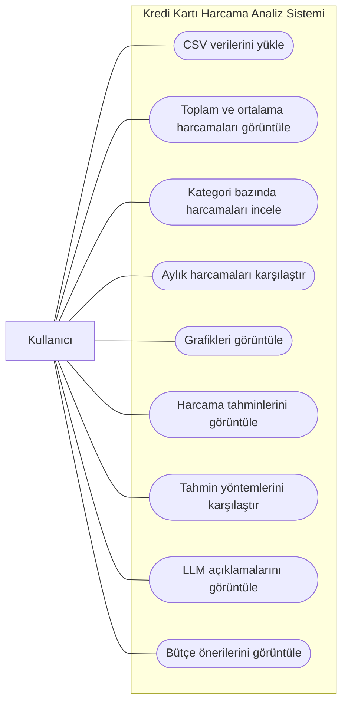

# Use Case Diyagramı

## 1. Amaç

Bu diyagram, kredi kartı harcamalarının analizi sisteminde kullanıcının gerçekleştirebileceği temel işlemleri göstermektedir.

## 2. Aktör

**Kullanıcı:** Harcama verilerini yükleyen, analiz sonuçlarını inceleyen ve bütçe önerilerini görüntüleyen kişidir.

## 3. Kullanım Senaryoları

- UC-01: Harcama verilerini CSV dosyasından yükleme
- UC-02: Toplam ve ortalama harcamaları görüntüleme
- UC-03: Kategori bazında harcamaları inceleme
- UC-04: Aylık harcamaları karşılaştırma
- UC-05: Analiz grafiklerini görüntüleme
- UC-06: Gelecek dönem harcama tahminlerini görüntüleme
- UC-07: Tahmin yöntemlerini karşılaştırma
- UC-08: LLM tarafından oluşturulan analiz açıklamalarını görüntüleme
- UC-09: Bütçe önerilerini görüntüleme

## 4. Diyagram

Aşağıdaki diyagram, kullanıcının sistem üzerinden gerçekleştirebileceği temel işlemleri göstermektedir.

